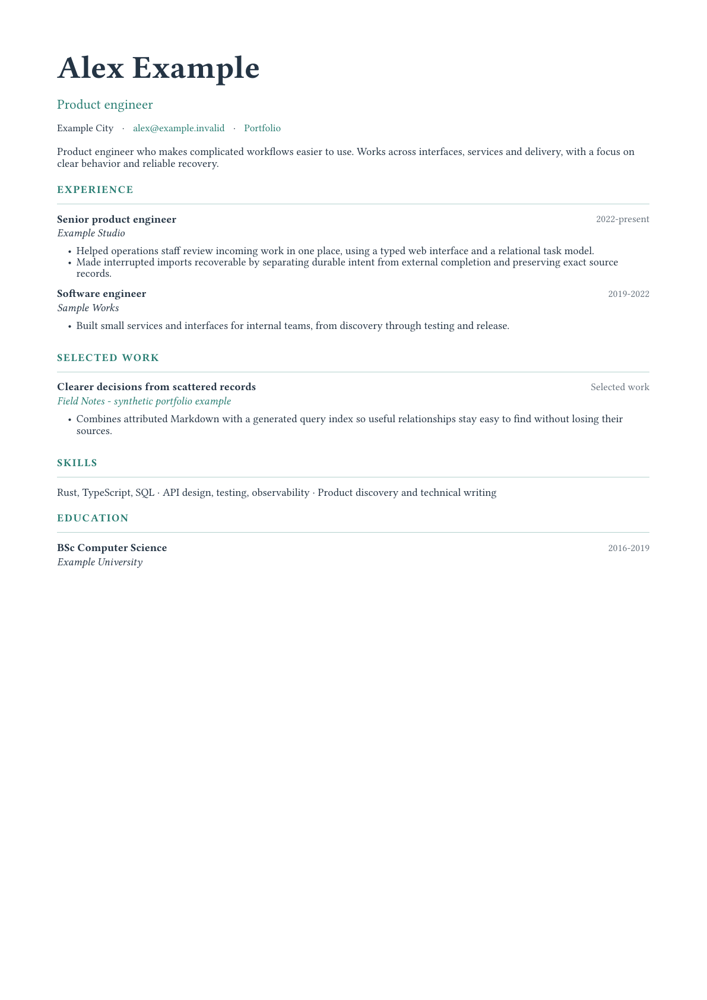

<div align="center">
  
  <h1>Job Harness</h1>
  <p><strong>Your career workspace. Any capable agent.</strong><br>A native toolkit that keeps context, commands and outcomes together.</p>
  <p><a href="https://github.com/KingPsychopath/job-harness/actions/workflows/ci.yml"></a>
  
  
  <a href="LICENSE"></a></p>
</div>


Job Harness gives humans and agents dependable tools for a private job search. Reuse sourced answers, check applications, prepare exact CV packets, reconcile email outcomes and recover interrupted work. One Rust engine serves the CLI, MCP, ACP handoffs and a small local dashboard.

- **Keep your history across agents.** Your workspace owns facts, answers, interviews, CVs and receipts.
- **Batch the predictable steps.** Discover focused schemas, chain local commands with result references, and handle partial failure explicitly.
- **Keep uncertainty visible.** A begun application stays blocked until its actual outcome is reconciled. Restarting a model never grants another submit.
- **Choose your host.** Bring an external agent, a compatible remote model API, or a local model. Browser, mail and calendar access remain host-owned.
- **Take your data with you.** Versioned private bundles preserve exact artifacts and unresolved attempts. The reusable repository contains no candidate profile.

**Private preview, Windows, macOS and Linux.** No public registry release or hosted service is required. The core does not require a model key, VM or network connection. Optional model sessions and external connectors need their own access.

## Start in three commands

After cloning this private repository and installing [Rust](https://rustup.rs):

```sh
./scripts/install.sh
job-harness --root "$HOME/Career/workspace" init
job-harness configure --workspace "$HOME/Career/workspace"
```

Add your approved PDF and attributed answers in that **separate workspace**. Bootstrap explains what is missing:

```sh
job-harness call bootstrap <<'JSON'
{"operation":"apply","capabilities":[]}
JSON
```

`jh status` gives a compact human view; `jh status --json` returns the same snapshot for agents.

[Installation and onboarding](docs/INSTALL.md) · [Runnable synthetic demo](examples/README.md)

Already have a CV? `job-harness source import --input approved-cv.pdf` preserves it as supplied evidence. No CV yet? Paste a rough note with `notes import`. [Capture and review](docs/INTAKE.md) · [Six short playbooks](resources/guides/workflows.md)

## Drive it your way

| Interface | What it does | Example |
|---|---|---|
| CLI | Compact JSON commands and pipelines | `job-harness call query_batch --input batch.json` |
| MCP | Tools for any supporting agent host | `job-harness connect mcp` |
| ACP client | Launch your external ACP agent with this workspace and MCP | `job-harness acp --agent /path/to/agent --prompt "Review my pipeline"` |
| Model host | Bounded tool loop for compatible local/remote chat APIs | `job-harness agent run --endpoint http://127.0.0.1:11434/v1 --model MODEL --prompt "Review unfinished work"` |
| Local dashboard | Read-only overview on loopback | `job-harness gui` |
| Rust library | Embed the same versioned API | `Engine::open(root)?.call(tool, &arguments)` |


MCP supplies tools; ACP connects a host to an agent. They are complementary protocols. Remote model keys are selected by **environment variable name**, never stored in workspace configuration or exports. Direct model sessions default to read-only tools; external actions require the host's connectors and current user scope. [Agent and model wiring](docs/AGENTS.md) · [Access boundaries](docs/AUTH.md)

The focused MCP profile advertises 11 tools. `inspect_tools` discovers specialized contracts; `query_batch` and `execute_batch` invoke them with exact references. The full profile exposes the complete catalog. Every engine call returns the same versioned envelope:

```json
{"schema_version":2,"ok":true,"data":{},"error":null,"next":[]}
```

`next` is guidance. A failed batch reports its committed steps and failing child; it is not rolled back or blindly replayed. [Contracts and working examples](resources/guides/job-harness-contract.md)

## Clear homes for code, data and access


| Home | Canonical responsibility |
|---|---|
| Reusable source and `resources/` | Domain rules, engine, protocols, generic skills and templates |
| Workspace `context/` and `applications/` | Sourced evidence, reusable answers, vacancy records, interview notes and outcomes |
| Workspace `content/`, `output/` and coordinator | Approved CV selection, exact artifacts, runs, attempts and idempotency |
| Workspace `config/` | Typed settings that select paths and workflows; never career facts |
| Derived SQLite index | Search, vacancy views and linked-source relationships; safely rebuildable |
| Host settings and credential store | Selected workspace, model/provider access, connector sessions and action permissions |

Markdown preserves human-readable attribution and flexible detail. SQLite materializes stable search and relationships. The submission journal remains the one authority for attempt state; the index cannot authorize a retry. This local coordinator supports multiple processes on one host. Multi-host/cloud coordination needs a separately designed transactional authority. [Architecture](docs/ARCHITECTURE.md)

## Backup, restore and CVs

```sh
job-harness workspace export --output "$HOME/Career/backup.jhb"
job-harness --root "$HOME/Career/restored" workspace import --input "$HOME/Career/backup.jhb"
job-harness workspace search "database"
```

Full bundles retain packets, receipts and unresolved attempts. Profile-only exports are refused while attempts are unresolved. Imports require a new or empty destination. Bundles are **private plaintext ZIPs**, not software artifacts; encrypt separately before sharing. [Format and recovery](docs/BUNDLES.md)

The optional evidence-linked [Typst CV generator](docs/CV.md) has typography/theme knobs, a one-page default and explicit approval/provenance. It never silently replaces your configured primary CV.

Use [selected document templates](docs/DOCUMENTS.md) for cover letters, answers, interview stories, portfolio pages and period reviews. Export Markdown/JSON with cited source identities. `workspace outcomes` shows denominators and pending cases without guessing which platform caused an outcome.

Optional [local model adapters](docs/MODELS.md) supply actual Gemma embeddings and Laya decisions. Exact search remains available without them. Downloads are explicit, revisions are pinned, and published comparisons stay separate from measured local results. General drafting and supplied-file transcription use replaceable compatible endpoints.



## Improve the toolkit

```sh
make check
make check-parity
make check-package
```

The operational loop uses the tools to handle career work. The development loop tests and improves those tools against synthetic fixtures, protocol checks and the historical compatibility oracle. Neither loop turns coaching or model output into career evidence.

[Contributing](CONTRIBUTING.md) · [Development](docs/DEVELOPMENT.md) · [Independent review](docs/REVIEW.md) · [Security](SECURITY.md) · [Roadmap](docs/ROADMAP.md)

MIT for the reusable software. Personal data belongs to its owner and stays outside the distribution.
