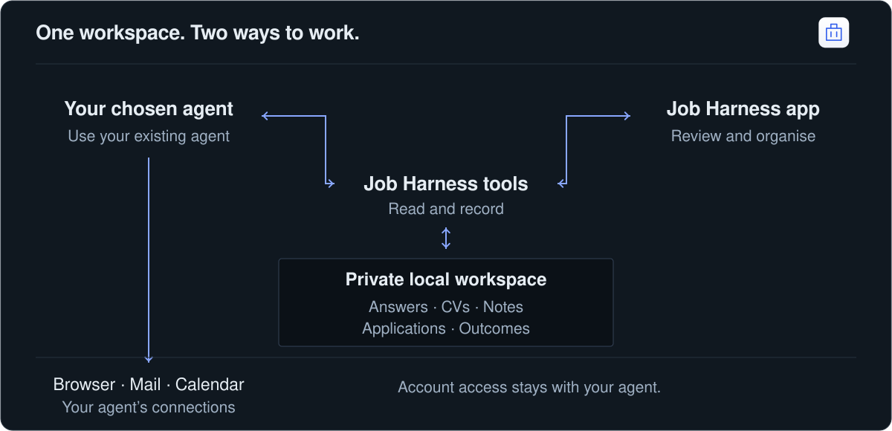
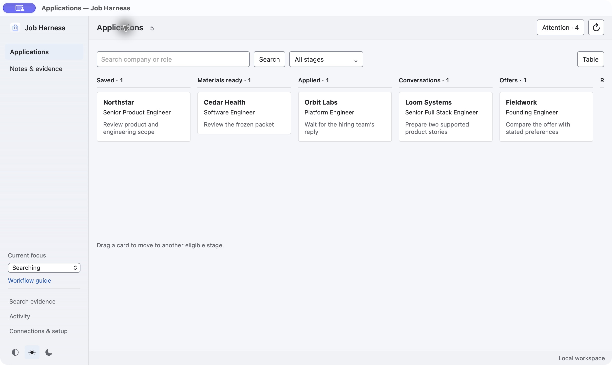

<div align="center">
  
  <h1>Job Harness</h1>
  <p><strong>Your career workspace. Any capable agent.</strong><br>Keep your history. Change your agent. Carry on.</p>
  <p>
    
    
    
    <a href="LICENSE"></a>
  </p>
  <p><a href="#start-once">Get started</a> · <a href="examples/README.md">Try the demo</a> · <a href="docs/AGENTS.md">Connect an agent</a> · <a href="#documentation">Documentation</a></p>
</div>



Job Harness keeps the evidence behind your job search together: answers, project stories, interviews, CVs and application history. Give your agent the tools, then ask for the work you want done.

## Start once

| You want to… | Start here |
|---|---|
| **Use your existing agent** — recommended | [Download the core toolkit](https://github.com/machineyearningengineer/job-harness/releases/tag/v0.2.0), then [connect your agent](docs/AGENTS.md). No compiler or extra model needed. |
| **Use a desktop window** | Add the optional desktop package. It opens the same private workspace. [App setup](docs/INSTALL.md). |
| **Open this repo in an agent project** | Clone it, open the folder in your agent and use the setup prompt below. Building from source needs Rust and a C toolchain. [Source setup](docs/INSTALL.md#build-from-the-toolkit-checkout). |

**Start with a simple prompt:**

> Set this up for me using my existing agent. Keep my career data separate from the software repo and use the tools and model I already have.

> Here's my CV. Help me create my job-search workspace.

> What needs my attention today?

Your agent can follow the [setup instructions](docs/AGENTS.md) and choose a native download or source build. Optional models stay optional.

For a terminal, create or select your separate private workspace:

```sh
jh setup --workspace "$HOME/Career/workspace"
```

Connect your agent, add your existing CV and confirmed answers, and start with one of the prompts above. Desktop, models and CV generation are optional. [Setup guide](resources/guides/job-harness-onboarding.md) · [Agent connection guide](docs/AGENTS.md)

Switch agents or stop using the toolkit while keeping your history. [Back up, disconnect or remove it](docs/INSTALL.md#leave-or-switch-tools).

**Private preview.** macOS, Linux and experimental Windows builds are available. Windows packages were cross-built and have not been run on Windows; a known notification stall is tracked in [issue 1](https://github.com/machineyearningengineer/job-harness/issues/1). Packages are unsigned. [Platform requirements and checksums](docs/INSTALL.md) · [Validation record](docs/VALIDATION.md)

## Ask your agent

**Check the day**

> Check my job search today. Show recruiting emails needing a reply, upcoming interviews and uncertain outcomes. Keep this read-only. No applications today.

**Update and tidy**

> Update my tracker from recruiting emails. Show resolved application confirmations and rejections for me to select before archiving. Keep unanswered requests visible. No applications today.

**Apply to roles**

> Apply to 20 suitable saved roles using my saved answers and primary CV. Check duplicates and save verified outcomes.

**Prepare for an interview**

> Brief me for [company]. Use the exact role, what I submitted, our correspondence and earlier interview notes.

**Keep useful notes**

> Save these notes so I can reuse them later. Show me any suggested updates before accepting them.

**Find the right story**

> Find a project story about improving a slow system. Show me the evidence.

Your agent brings its own browser, email and calendar connections. A daily review shows when mail was last checked; saved information is distinct from a fresh inbox scan. Archiving uses your reviewed selection and keeps evidence of the verified result. Checking or updating your day never starts applications. [Everyday workflows](resources/guides/workflows.md) · [Access and permissions](docs/AUTH.md)

The first-class daily tools are available in current source builds. The immutable
v0.2.0 preview predates them; use [source setup](docs/INSTALL.md#build-from-the-toolkit-checkout)
for this workflow until the next packaged release.

## See where things stand

The optional desktop app uses the same workspace as your agent. Move a card, review a note or inspect its original source; your agent sees the change next time.



[Preview Notes & evidence](docs/assets/note-review.png) · [Explore the fictional demo](examples/README.md) · [View a sample CV](examples/cv/example.pdf)

## Documentation

| Use your workspace | Build with the toolkit |
|---|---|
| [Daily review and mail cleanup](resources/guides/daily-review.md) · [Notes and evidence](docs/INTAKE.md) · [CVs](docs/CV.md) | [Architecture](docs/ARCHITECTURE.md) · [Tool contracts](resources/guides/job-harness-contract.md) |
| [Backup and restore](docs/BUNDLES.md) · [Optional models](docs/MODELS.md) | [Contributing](CONTRIBUTING.md) · [Development](docs/DEVELOPMENT.md) · [Roadmap](docs/ROADMAP.md) |

The reusable software contains no candidate profile or credentials. Your private data stays in a separate, portable workspace. MIT software; [third-party components](docs/THIRD_PARTY.md) keep their own licenses.
