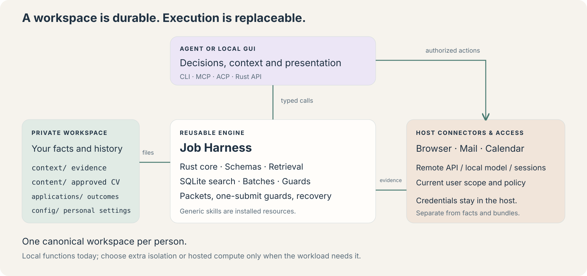

# Workspace first

An agent needs relevant context, commands/tools and a durable workspace. Compute is an implementation choice. Job Harness keeps the workspace independent of the agent, model, process and package installation.

## Separate responsibilities

The workspace holds attributed facts under context, approved CV selection under content, and vacancies/outcomes/evidence under applications. Personal configuration selects relative data paths and timezone; it is not proof of a career claim. The coordinator stores runs, attempts, action IDs and immutable packet references. Generated pipeline views are rebuilt from canonical vacancy records.

The engine implements `Harness(root).call(tool, arguments)`. CLI and local stdio MCP delegate to that API. Every tool declares input/output schemas and returns a versioned data/error/next envelope. Root selection happens at trusted host startup; no MCP tool can switch candidates. Generic skills and guides ship as package resources, with one `.agents/skills` discovery symlink in the source checkout.

The host supplies model access and browser/mail/calendar drivers. A capability declaration is not access proof or authority. External actions require current user scope and live observations. Credentials stay in the host's credential store; the model receives only the results it needs. Agents and a future GUI decide what to do and display outcomes. Neither chat memory nor a generated view can replace sourced records.

## Context and commands

Bootstrap returns routing, settings, configuration gaps and recovery counts. Retrieve metadata first; load the focused skill and complete relevant evidence on demand. Page through results before claiming exhaustive coverage. `query_batch` groups reads; `execute_batch` sequences local operations and resolves exact data references. Each mutation commits independently, and a failed child forwards recovery guidance. No arbitrary shell, Python or JavaScript is evaluated by batch references.

The focused MCP catalog keeps common operations visible and loads specialized schemas through inspect_tools. The full catalog supports hosts that need direct child-tool authorization. Local batches never perform an external submission. The host must inspect batch children if it requires per-child authorization.

## Durable coordination

One local coordinator per workspace uses shared read locks, exclusive write locks, atomic fsynced files and a recoverable journal. A packet freezes exact CV, answers and source hashes. `begin_submission` is a separate one-shot boundary. An interrupted/unknown attempt never expires; resolve its real external outcome before retrying. Older receipts must preserve later interview or rejection states.

A bundle is a snapshot for deliberate transfer, not live synchronization. Copying a workspace to two machines gives independent coordinators. Multi-host execution needs a single authenticated coordinator with transactional compare-and-set/leases, plus per-user data isolation. Do not assume network-mounted files or a Durable Object automatically reproduce local locking guarantees.

## Choose compute for the actual operation

| Work | Current or suitable runtime | Durable state |
|---|---|---|
| Inspect facts, prepare packets, update history | Local Python functions | Private workspace |
| Fill authenticated job forms, review mail, book meetings | Existing host connectors/browser sessions | Workspace evidence; sessions in host credential/session stores |
| Run untrusted third-party code | Host-selected restricted ephemeral sandbox | Deliberately exported artifacts only |
| Test a native desktop workflow | A suitable device or VM | Separate test evidence |
| Coordinate several cloud workers | Authenticated service with transactional storage | External workspace/coordinator, independent of workers |

Persistent VMs, ephemeral sandboxes, durable services and interpreters answer different questions. A worktree separates Git edits; it is not a security sandbox. Keeping a browser session or warmed build cache can be useful. No infrastructure primitive should become the owner of the candidate's career facts.

Keep durable state, compute lifetime and security isolation as three separate choices. A forked authenticated VM can duplicate browser sessions and coordination state. Base images must exclude them, or workers must use a single canonical writer. Authorized read-only access to related context can help an agent; competing writes to shared mutable state need ownership. Tool-call counts and context costs should be measured by the host, rather than inferred from ledger event counts.

The “magic compute box” idea is useful as an execution interface, but it still needs identity, permissions, resource limits, artifact transfer and trustworthy completion evidence. Job Harness provides the workspace/tool contract; it does not claim to implement a generic cloud execution service.

## Why Python

The current engine is dominated by JSON, paths, hashing, files, URL normalization and Unix locking. Python's standard library covers those needs, the existing implementation is tested, and a wheel bundles the command and generic resources without runtime dependencies. This is an engineering choice for this engine, not a claim that Python is universally best for agents.

Go would simplify native single-binary delivery; TypeScript fits a web GUI. Either can call or later replace the versioned API. Keep domain invariants and candidate data independent of that choice. [Packaging](INSTALL.md), [auth boundaries](AUTH.md), [decision record](adr/001-workspace-and-execution.md).

## Sources and limits

This design applies the just-in-time context principle from [Anthropic's context-engineering guidance](https://www.anthropic.com/engineering/effective-context-engineering-for-ai-agents). The [MCP authorization specification](https://modelcontextprotocol.io/specification/2025-06-18/basic/authorization) distinguishes local stdio from HTTP authorization. [Python packaging metadata](https://packaging.python.org/en/latest/guides/writing-pyproject-toml/) supplies the installable command and resources.

These sources inform the design; they do not certify this implementation. Tests and live checks are recorded separately in [development](DEVELOPMENT.md). Windows, multi-host writes, arbitrary sandbox execution and a GUI remain outside this preview.
