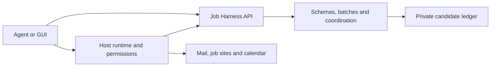

# Job Harness — onboarding

Job Harness is reusable tooling for a private job-search ledger. It provides workflows, typed tools, bounded batches, submission coordination and evidence-backed tracking. An agent or GUI supplies the external mail, browser and calendar capabilities. Python 3.11+ on macOS/Linux is the supported local runtime; Windows and shared cross-machine storage are not verified.

## How it runs



The agent supplies decisions; Job Harness runs predictable local steps and keeps durable evidence. The host runtime supplies live actions and permissions. Each private workspace holds one candidate's configuration and career records.

## Four separate homes

| Home | Contains | Share with the toolkit? |
|---|---|---|
| `job_harness/` and generic skills/guides | Tool contracts, coordination, adapters, workflow defaults and onboarding | Yes, through the code-only repository or wheel |
| Each ledger's `config/` | Timezone, CV path, answer-source paths and optional workflow overrides | No; owner-specific configuration |
| Each ledger's `context/`, `content/`, `applications/`, `output/` | Facts, approved CV, preferences, vacancies, history, exact packets and receipts | No; private candidate data |
| Agent/GUI host | Model choice, connector bindings, credentials, user permissions and scheduling | No; host-owned runtime/access |

Configuration selects data; it is not evidence for a career claim. Each candidate has a separate ledger/root and coordinator. Switching root is a trusted host startup choice, never an argument available to an agent tool. Agents sharing one candidate must share the same checkout/coordinator. Copies on different machines have independent locks.

## Try it without personal information

From the toolkit directory, create an empty private ledger outside it:

```sh
python3 -m job_harness --root /path/to/private-ledger init
python3 -m job_harness --root /path/to/private-ledger call bootstrap <<'JSON'
{"operation":"reconcile","capabilities":[]}
JSON
python3 -m job_harness schemas execute_batch
python3 -m job_harness config-schema ledger
```

Initialization builds a temporary sibling directory and moves it into place only after success. It refuses to replace a nonempty directory. It creates blank answer/evidence records and neutral configuration; it copies no salary, contact details, CV, demographic answer or career history. Set primary_cv to a repository-relative PDF path, set the IANA timezone, and supply attributed career records/approved answers. Missing personal facts remain missing. Generic skills, operating guides and workflow defaults stay in the toolkit; read_record resolves them there and returns origin=toolkit. They are not copied into each candidate ledger. A private file at the same allowed path is an explicit owner override.

Wire a stdio MCP client to this command, using absolute paths and the toolkit directory as its working directory:

```text
job-harness --root /path/to/private-ledger mcp --tool-profile focused
```

Use `job-harness --root /path/to/private-ledger connect mcp` to print a client-neutral command/args pair with a stable interpreter and safe module search path. Skill installation is optional; any agent can read the focused skill returned by bootstrap through read_record. A fresh client session may be needed after configuring a new MCP. Always test bootstrap through the actual connection; registration alone is not live-tool proof.

For Python or a GUI backend:

```python
from job_harness.service import Harness
from job_harness.contracts import SPECS

harness = Harness("/path/to/private-ledger")
result = harness.call("bootstrap", {"operation": "apply", "capabilities": []})
# Render result; bind missing capabilities using the host's own providers.
```

Use `query_batch` to fetch related records/answers together, `execute_batch` to organize local updates with result references, and `prepare_application` to freeze/reserve with one call. See the [contract and working examples](job-harness-contract.md). Actual external submissions still use a separate begin/one-submit/outcome boundary.

## Share tooling, never a ledger

Install the wheel or clone the code-only repository. Generic resources ship inside the Python package; there is no second source-export implementation. Each recipient creates their own external workspace or imports an explicitly private .jhb bundle. Bundles contain personal data and are never part of the software distribution. Host credentials and connector sessions remain separate.
